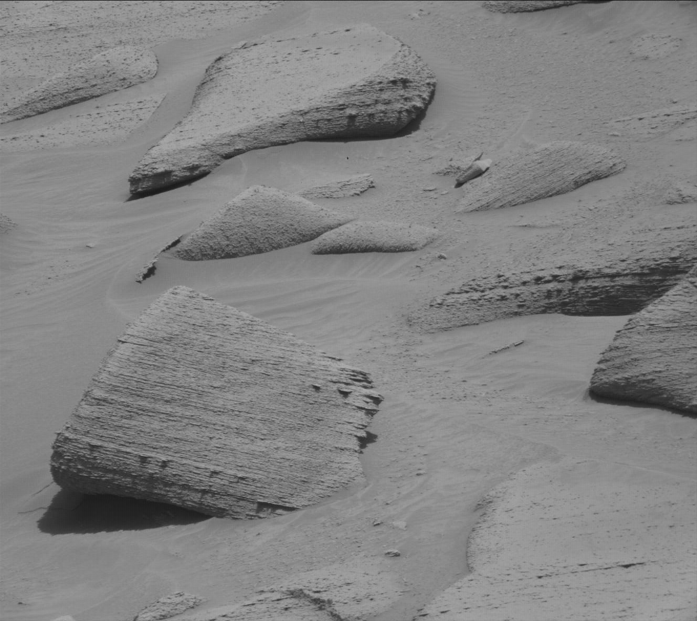

# mastcam-demosaic

De-mosaic (colorize) raw Bayer-pattern images from the Curiosity rover's
MastCam, following the process described in Emily Lakdawalla's article
[Curiosity's MastCam: Bayer pattern](https://www.planetary.org/articles/08241439-mastcam-bayer).

## How it works

MastCam's detector is covered with a Bayer filter, so each pixel records only
red, green or blue light. One row goes red, green, red, green, ... and the next
row goes green, blue, green, blue, ... (an **RGGB** pattern), so there are two
green pixels for every red and every blue pixel. The raw images posted by NASA
are just these pixel values shown in grayscale, so they look like a fine
checkerboard.

To get a color image:

1. Take the green pixels and interpolate values into the positions where the
   red and blue pixels were.
2. Take the blue pixels and interpolate values into the red and green
   positions.
3. Do the same for the red pixels.
4. Combine the three full-resolution channels into an RGB image.

This tool uses **bilinear interpolation**: each missing value is the weighted
average of the nearest pixels of that color (direct neighbours weigh twice as
much as diagonal ones). Pixels that were recorded are kept unchanged.

## Installation

With [pipx](https://pipx.pypa.io/):

```sh
pipx install .
```

or with pip:

```sh
pip install .
```

You can also install straight from a git URL, e.g.

```
pipx install git+https://github.com/MonkeeSage/mastcam-demosaic
```

## Usage

```sh
mastcam-demosaic INPUT [-o OUTPUT] [-p PATTERN] [-q QUALITY]
```

| Option | Description |
| --- | --- |
| `INPUT` | Path to the raw Bayer image. |
| `-o`, `--output` | Where to save the result. Defaults to the input path with `.demosaic` before the extension (`a.jpg` becomes `a.demosaic.jpg`). |
| `-p`, `--pattern` | Bayer layout of the top-left 2x2 pixels: `RGGB` (default, MastCam), `BGGR`, `GRBG` or `GBRG`. Useful if an image has been cropped by an odd number of pixels. |
| `-q`, `--quality` | JPEG quality of the output, 1-95 (default 95). |

The output format is chosen from the output file's extension, so
`-o result.png` writes a PNG.

Example:

```sh
mastcam-demosaic examples/3796MR1038740091504464C00_DXXX.jpg
# Saved examples/3796MR1038740091504464C00_DXXX.demosaic.jpg
```

It can also be run as a module: `python -m mastcam_demosaic INPUT`.

## Example

Raw MastCam image `3796MR1038740091504464C00_DXXX` from sol 3796, from the
[MSL raw images](https://mars.nasa.gov/msl/multimedia/raw-images/) site.

| Raw Bayer image | De-mosaiced |
| --- | --- |
|  |  |

## Limitations

- Raw MastCam JPEGs are compressed after the Bayer pattern is applied, so
  compression artifacts can show up as color fringes. More advanced
  demosaicing algorithms can reduce this.
- No white balance or color correction is applied. The colors are the raw
  camera colors, which is roughly how the scene would look under Mars
  lighting.
