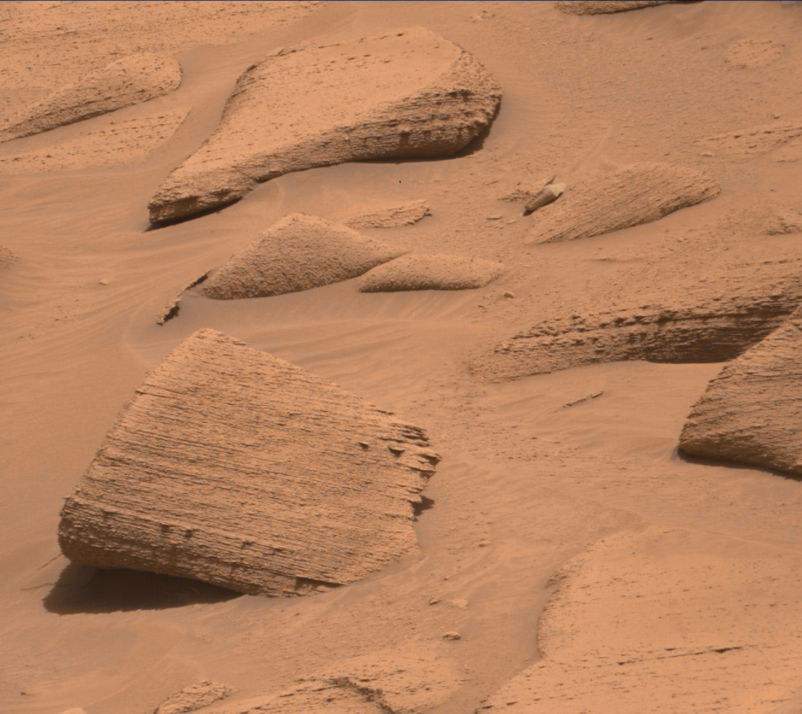
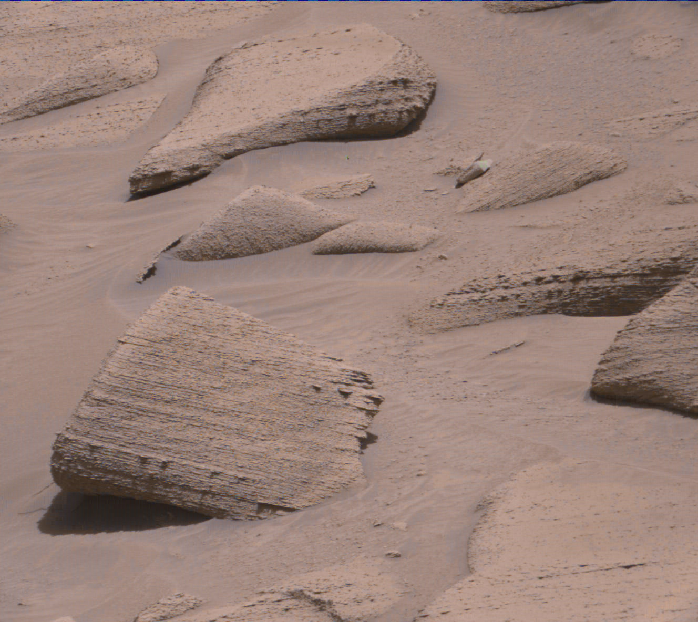

# mastcam-demosaic

De-mosaic (colorize) raw Bayer-pattern images from the Curiosity rover's
MastCam, following the process described in Emily Lakdawalla's article
[Curiosity's MastCam: Bayer pattern](https://www.planetary.org/articles/08241439-mastcam-bayer).

## How it works

MastCam's detector is covered with a Bayer filter, so each pixel records only
red, green or blue light. One row goes red, green, red, green, ... and the next
row goes green, blue, green, blue, ... (an **RGGB** pattern), so there are two
green pixels for every red and every blue pixel. The raw images posted by NASA
are just these pixel values shown in grayscale, so they look like a fine
checkerboard.

To get a color image:

1. Take the green pixels and interpolate values into the positions where the
   red and blue pixels were.
2. Take the blue pixels and interpolate values into the red and green
   positions.
3. Do the same for the red pixels.
4. Combine the three full-resolution channels into an RGB image.

This tool uses **bilinear interpolation**: each missing value is the weighted
average of the nearest pixels of that color (direct neighbours weigh twice as
much as diagonal ones). Pixels that were recorded are kept unchanged.

### Color modes

By default the output shows the **raw** camera colors, like the color images
on NASA's raw image site. Two optional, mutually exclusive flags calibrate the
color in the ways shown in NASA's
[Raw, Natural, and White-Balanced Views of Martian Terrain][pia16800]:

- `--natural` estimates **natural color**: approximately what the colors
  would look like to a person standing on Mars, under the reddish light
  filtered through the dusty Martian atmosphere.
- `--white-balanced` estimates the colors of the terrain **as if lit by
  Earth-like rather than Martian light**. This helps geologists compare rocks
  with ones they know from Earth. It tends to make the sky look too blue
  ([PIA16768][pia16768]).

Both modes follow the MastCam calibration papers (Bell et al., 2017; Malin et
al., 2017):

1. **Decompand.** On the rover, each 11-bit pixel value has its bias level
   subtracted and is then "companded" down to 8 bits with a square-root-like
   lookup table [Bell §3.2.2, §5.2.2]. Color corrections are multiplicative,
   so the 8-bit values are first converted back to linear 11-bit values with
   MastCam's standard decompanding "Lookup Table 0" [Bell Appendix B]. The
   same table is used by [mars-raw-utils][mru].
2. **De-mosaic** in linear space as described above.
3. **Scale each channel** by a set of coefficients:

   | Mode | R | G | B | Source |
   | --- | --- | --- | --- | --- |
   | `--natural` | 1.20 | 1.00 | 1.00 | MastCam color correction factors [Bell §5.2.8, Eq. 13; Malin §9.5], with blue adjusted (see below) |
   | `--white-balanced` | 1.00 | 1.16 | 1.86 | Multipliers for "essentially white balanced color images" [Malin §9.5] |

   The published natural color factors were derived from pre-flight images of
   a Macbeth ColorChecker chart under Earth sunlight. They correct for the
   camera's spectral response but keep the color of the light falling on the
   scene, which on Mars is the reddish Martian daylight. The white balance
   multipliers also remove that reddish tint. Each set is divided by its green
   value, which keeps the brightness of the raw image and avoids clipping
   highlights. The JPEGs don't record the exposure time, so the absolute
   brightness can't be calibrated anyway.
4. **Compand** back to 8 bits with Lookup Table 0, as is done for the
   color-corrected products in NASA's Planetary Data System archive
   [Bell §5.2.8].

As a check, the same per-channel gains were measured between the raw and the
calibrated panels of NASA's [comparison image][pia16800], in linear space:

| | R / G | B / G |
| --- | --- | --- |
| NASA white-balanced panel | 0.88 | 1.72 |
| `--white-balanced` (1.00 / 1.16, 1.86 / 1.16) | 0.86 | 1.60 |
| NASA natural panel | 1.21 to 1.25 | 0.96 to 1.03 |
| Published natural factors (1.20, 1.00, 1.26) | 1.20 | 1.26 |
| `--natural` (1.20, 1.00, 1.00) | 1.20 | 1.00 |

The white balance multipliers match NASA's example well, so they are used
unchanged. For natural color, the published red factor matches, but NASA's
panel uses much less blue than the published factor of 1.26. With 1.26,
the output has a noticeable pink cast that NASA's example doesn't have.
**`--natural` therefore differs from the published coefficients: blue is
left unscaled (1.00 instead of 1.26)**, which is within the range measured
from NASA's panel and gives the orange-brown look of NASA's natural color
image. Red (1.20) and green (1.00) are the published values. The panels in
that figure were also contrast-stretched for presentation, which this tool
does not do.

## Installation

With [pipx](https://pipx.pypa.io/):

```sh
pipx install .
```

or with pip:

```sh
pip install .
```

You can also install straight from a git URL, e.g.

```
pipx install git+https://github.com/MonkeeSage/mastcam-demosaic
```

## Usage

```sh
mastcam-demosaic INPUT [-o OUTPUT] [-p PATTERN] [--natural | --white-balanced] [-q QUALITY]
```

| Option | Description |
| --- | --- |
| `INPUT` | Path to the raw Bayer image. |
| `-o`, `--output` | Where to save the result. Defaults to the input path with `.demosaic` before the extension (`a.jpg` becomes `a.demosaic.jpg`). |
| `-p`, `--pattern` | Bayer layout of the top-left 2x2 pixels: `RGGB` (default, MastCam), `BGGR`, `GRBG` or `GBRG`. Useful if an image has been cropped by an odd number of pixels. |
| `--natural` | Calibrate to estimated natural color, as seen on Mars (see [Color modes](#color-modes)). |
| `--white-balanced` | Calibrate and white balance, as if under Earth-like lighting. Cannot be combined with `--natural`. |
| `-q`, `--quality` | JPEG quality of the output, 1-95 (default 95). |

The output format is chosen from the output file's extension, so
`-o result.png` writes a PNG.

The color flags only change the colors, not the default output name, so use
`-o` to keep several versions side by side.

Examples:

```sh
mastcam-demosaic examples/3796MR1038740091504464C00_DXXX.jpg
# Saved examples/3796MR1038740091504464C00_DXXX.demosaic.jpg

mastcam-demosaic examples/3796MR1038740091504464C00_DXXX.jpg --natural \
    -o examples/3796MR1038740091504464C00_DXXX.natural.jpg

mastcam-demosaic examples/3796MR1038740091504464C00_DXXX.jpg --white-balanced \
    -o examples/3796MR1038740091504464C00_DXXX.white-balanced.jpg
```

It can also be run as a module: `python -m mastcam_demosaic INPUT`.

## Example

Raw MastCam image `3796MR1038740091504464C00_DXXX` from sol 3796, from the
[MSL raw images](https://mars.nasa.gov/msl/multimedia/raw-images/) site.

| Raw Bayer image | De-mosaiced |
| --- | --- |
|  |  |

| `--natural` | `--white-balanced` |
| --- | --- |
|  |  |

## Limitations

- Raw MastCam JPEGs are compressed after the Bayer pattern is applied, so
  compression artifacts can show up as color fringes. More advanced
  demosaicing algorithms can reduce this.
- The color modes are approximations. NASA's calibration pipeline also applies
  flat field, dark current and shutter smear corrections and a full
  radiometric calibration, which need data that isn't available for the JPEGs
  on the raw image site.
- `--natural` and `--white-balanced` expect 8-bit companded images as
  published on the raw image site. They reject 16-bit input, which is
  assumed to be already decompanded or calibrated.

## References

- Lakdawalla, E. (2012), [Curiosity's MastCam: Bayer pattern](https://www.planetary.org/articles/08241439-mastcam-bayer),
  The Planetary Society.
- NASA/JPL-Caltech/MSSS (2013), [Raw, Natural, and White-Balanced Views of Martian Terrain (PIA16800)][pia16800].
- NASA/JPL-Caltech/MSSS (2013), [Mount Sharp Panorama in White-Balanced Colors (PIA16768)][pia16768].
- **[Bell]** Bell, J. F., III, et al. (2017), The Mars Science Laboratory
  Curiosity rover Mastcam instruments: Preflight and in-flight calibration,
  validation, and data archiving, *Earth and Space Science*, 4, 396–452,
  [doi:10.1002/2016EA000219](https://doi.org/10.1002/2016EA000219)
  ([preprint PDF](https://molokai.sese.asu.edu/~jimbo/Mastcam_Calibration_2017_REVISED_with_figures_sm.pdf)).
- **[Malin]** Malin, M. C., et al. (2017), The Mars Science Laboratory (MSL)
  Mast cameras and Descent imager: Investigation and instrument descriptions,
  *Earth and Space Science*, 4, 506–539,
  [doi:10.1002/2016EA000252](https://doi.org/10.1002/2016EA000252)
  ([open access full text](https://pmc.ncbi.nlm.nih.gov/articles/PMC5652233/)).
- [mars-raw-utils][mru], K. Gill et al., used as a cross-check for the
  decompanding table.

[pia16800]: https://science.nasa.gov/resource/raw-natural-and-white-balanced-views-of-martian-terrain/
[pia16768]: https://www.jpl.nasa.gov/images/pia16768-mount-sharp-panorama-in-white-balanced-colors/
[mru]: https://github.com/MarsRaw/mars-raw-utils
